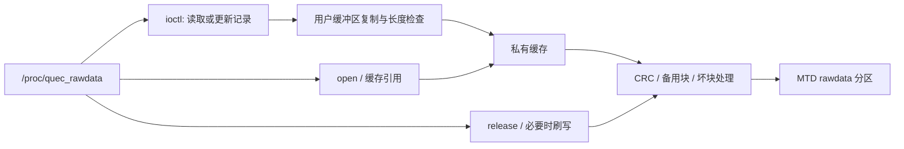

# QRAWDATA 原厂实现与 TUN ABI 核对

2026-11-13 的结论：**已从本机保存的原厂内核中定位并还原 QRAWDATA 的主要实现。它是 procfs 下的私有持久化记录存取接口，后端为 `rawdata` MTD 闪存分区；没有发现它直接改变或依赖 TUN 的网络 ABI。原厂共享 `file_operations` 操作表与 GCC 4.9.3 候选头文件布局也一致。**

因此，QRAWDATA 这一具体配置项不再属于“实现完全未知”的 TUN 移植障碍。此结论仍不等于证明整个厂商内核所有 ABI 相同，也不替代驱动加载与收发验收。

本轮**完全离线**：未访问模块，未读取 `rawdata` 分区中的实际记录，未打开 `/proc/quec_rawdata`，未执行任何 ioctl、加载、写配置、重启或刷机操作。

## 证据来源与工具

- 原厂内核 Image SHA-256：`62daa067512597e59b952f45be8cd5b6d34fc75265d0f60c5a3b8b8f09ecea2a`，沿用前一轮已核对内嵌 IKCONFIG 的启动分区采集。
- ARM32 小端映射基址：`0xc0008000`。
- 内核导出 API 名称来自同一镜像恢复的 6,144 项导出表，前一轮用原厂模块依赖交叉检查通过。
- 独立工具：GNU objdump、Capstone 5.0.9、pyelftools 0.33。布局探针使用已固定的 GCC 4.9.3 容器和 TUN 实际 Kbuild 编译参数。
- REA CLI 6.5.0 的原始镜像分析路径返回 `target_format_unsupported`：Hopper 适配器不支持该 raw-binary 入口，Ghidra 未配置。没有修改客户端注册或安装引擎。下述证据来自明确标识的普通静态工具，**不声称成功取得 REA 原生反编译 Evidence**。
- 本轮公开检索仍未找到 QRAWDATA 的原始源文件。文中的私有函数名、字段名和伪代码是分析标签，不是原厂符号或原始 C 源码。

将 `CONFIG_QRAWDATA` 与 `quec_rawdata` 接口关联，依据的是配置名、接口名、后端分区及恢复的记录存取行为。原始 Kconfig/Makefile 依赖行仍未取得，因此不声称恢复了源码级选项依赖关系；以下地址、调用、参数和操作表证据均来自实际原厂镜像。

## 已定位的入口与接口

| 项目 | 原厂证据 |
| --- | --- |
| procfs 文件名 | `quec_rawdata` |
| 初始化入口 | `0xc05dfc8c` |
| 注册调用点 | `0xc05dfca8`，调用导出 API `proc_create_data` |
| 注册参数 | `proc_create_data("quec_rawdata", 0, NULL, &ops, NULL)` |
| 操作表地址 | `0xc04d81e8` |
| open 回调 | `0xc038f794`，调用私有缓存获取/初始化逻辑 |
| release 回调 | `0xc038f9d8`，调用缓存引用释放及必要时刷写逻辑 |
| unlocked_ioctl 回调 | `0xc038fb6c` |
| 读取命令 | `0x50001` |
| 写入命令 | `0x50002` |
| 用户结构 | 136 字节：编号位于偏移 0，长度位于偏移 4，最多 128 字节 payload 位于偏移 8 |
| 编号范围 | ioctl 检查编号不大于 3；四项长度常量为 76、128、8、73 |
| 后端分区 | 字符串 `rawdata`，通过 `get_mtd_device_nm` 打开 |
| 私有状态 | `0xc06896b8`：MTD 指针、引用计数、缓存指针；互斥锁位于 `0xc062ac40` |

这些编号和长度只是固件中的接口常量。没有读取记录内容，也没有给记录附加设备身份等未经核实的业务含义。

操作表没有 read/write 回调。私有存取通过 ioctl 完成，不能把普通文件读取或只读打开自动当作无副作用的探针；release 的可达路径包含闪存刷写。

## 实现路径



从实际指令可还原如下逻辑轮廓，省略了完整错误路径与缓存内部算法：

```c
/* 解释性伪代码；不可用于构建或部署。 */
struct record_request {
    uint32_t index;
    uint32_t length;
    uint8_t payload[128];
};

open(...) {
    cache_acquire();
    return 0;
}

ioctl(..., command, user_buffer) {
    if (command == 0x50001) {
        copy_request_from_user();
        check_index_at_most_3();
        cache_acquire();
        request.length = fixed_lengths[request.index];
        copy_record_from_cache();
        copy_response_to_user();
        cache_release();
    } else if (command == 0x50002) {
        copy_request_from_user();
        check_index_and_expected_length();
        cache_acquire();
        update_cached_record_and_mark_dirty();
        cache_release();
    }
}

release(...) {
    cache_release(); /* 可达路径：校验、MTD 写入/擦除及坏块处理 */
    return 0;
}
```

缓存获取经 `get_mtd_device_nm("rawdata")` 取得闪存对象，按 MTD 页和擦除块几何参数读取备用记录并检查校验。更新仅修改私有缓存，释放/刷写路径调用 MTD 写入、擦除和坏块标记函数。

## 完整可达调用核对

以初始化入口和三个文件操作回调为根，跟踪 ARM 条件分支的两条路径、直接调用和尾调用，遇到返回即停止，不把后续字面量池当作指令。总计遍历 **596 条可达指令**，没有未知直接目标、未解析的计算跳转或间接调用。

所有外部调用目标共 19 个：

| 类别 | 外部 API |
| --- | --- |
| procfs | `proc_create_data` |
| MTD | `get_mtd_device_nm`、`put_mtd_device`、`mtd_read`、`mtd_write`、`mtd_erase`、`mtd_block_isbad`、`mtd_block_markbad` |
| 内存及算术 | `__kmalloc`、`kmalloc_order`、`kfree`、`__memzero`、`memcpy`、`memcmp`、`__udivsi3` |
| 同步 | `mutex_lock`、`mutex_unlock` |
| 用户缓冲区 | `arm_copy_from_user`、`arm_copy_to_user` |

未发现网络设备、socket、skb、netfilter、XFRM、netlink 或 TUN 注册/收发 API。与候选 TUN 导入表的共同项仅为 `__kmalloc`、`__memzero`、`kfree` 和两个用户缓冲区复制函数，属于通用内核设施。

这里把已命名的导出内核 API 作为调用边界，没有重新证明这些内核公共 API 自身的全部内部实现；MTD 内部的硬件回调也不被描述成驱动自有的已解析代码。

## 对 TUN ABI 的直接核对

### 共享文件操作表

同一 GCC 4.9.3、同一份目标配置和候选头文件编译的探针给出：

| 字段 | 候选头文件 | 原厂 QRAWDATA 表 |
| --- | --- | --- |
| `sizeof(struct file_operations)` | 116 字节 | 操作表到下一 CRC 表的跨度为 116 字节 |
| `unlocked_ioctl` | 偏移 40 | 指向私有 ioctl 回调 |
| `open` | 偏移 52 | 指向缓存获取回调 |
| `release` | 偏移 60 | 指向缓存释放回调 |

原厂表的 29 个指针槽中，仅上述三个非零。下一 CRC 表地址还由私有 CRC 例程中的实际字面量指针 `0xc04d825c` 交叉确认。没有观察到 QRAWDATA 在共享操作表中增加成员或改变这三个成员的偏移。

### 配置宏与网络类型

前一轮的逐项恢复实验已证明：在候选 3.18.44 的实际 TUN 编译单元及 515 个依赖文件中，加回 `CONFIG_QRAWDATA=y` 不改变预处理结果或 `tun.o`。本轮又在实际原厂实现中确认其状态来自 MTD 对象及独立分配的私有缓存，可达实现没有网络对象来源、网络注册路径或 TUN 钩子调用。

**针对这份固件，未发现 QRAWDATA 引入 TUN ABI 变更的路径；可以排除已恢复实现中的直接 TUN 依赖和上述共享文件操作表布局冲突。**

仍保留的边界是：原厂完整源码及编译器补丁没有全部取得，`CONFIG_MODVERSIONS=n` 无法做原厂符号类型 CRC 核对，其他未公开补丁可能存在。因此不把本项分析升级成“整个内核所有 ABI 已证明完全相同”。

## 复现与留档

机器可读证据见 [qrawdata-result.json](qrawdata-result.json)。脚本固定内核摘要并在未知目标或计算跳转出现时失败，不适用于其他固件。

```sh
python3 -m pip install --target /Users/shield/Documents/ChatGPT/DJI-4G/tun-validation-local/qrawdata-analysis/python-deps -r tools/tun-validation/qrawdata-requirements.txt

tools/tun-validation/qrawdata_probe.sh /Users/shield/Documents/ChatGPT/DJI-4G/tun-validation-local

python3 tools/tun-validation/qrawdata_inspect.py /Users/shield/Documents/ChatGPT/DJI-4G/tun-validation-local --deps /Users/shield/Documents/ChatGPT/DJI-4G/tun-validation-local/qrawdata-analysis/python-deps

PYTHONPATH=/Users/shield/Documents/ChatGPT/DJI-4G/tun-validation-local/qrawdata-analysis/python-deps python3 -m unittest discover -s tools/tun-validation -p 'test_*.py'
```

22 项单元测试通过，新增检查覆盖条件分支、直接调用、返回后的字面量池、间接调用拒绝和操作表偏移。汇编、工具诊断及完整指令路径保留在电脑的 `qrawdata-analysis/`，原始内核及设备数据不提交到仓库。本轮未修改上一轮 GCC 4.9.3 的 TUN 驱动产物。
